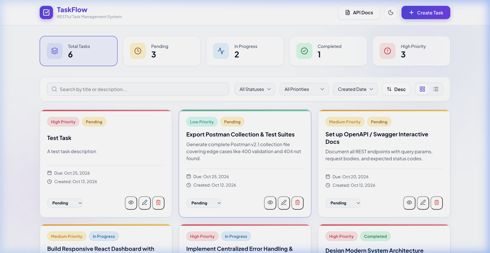
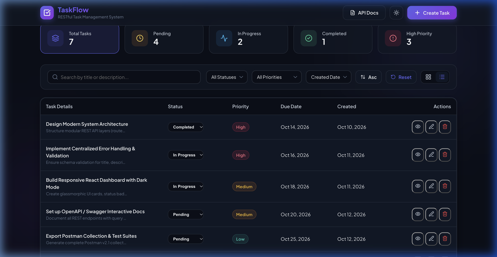
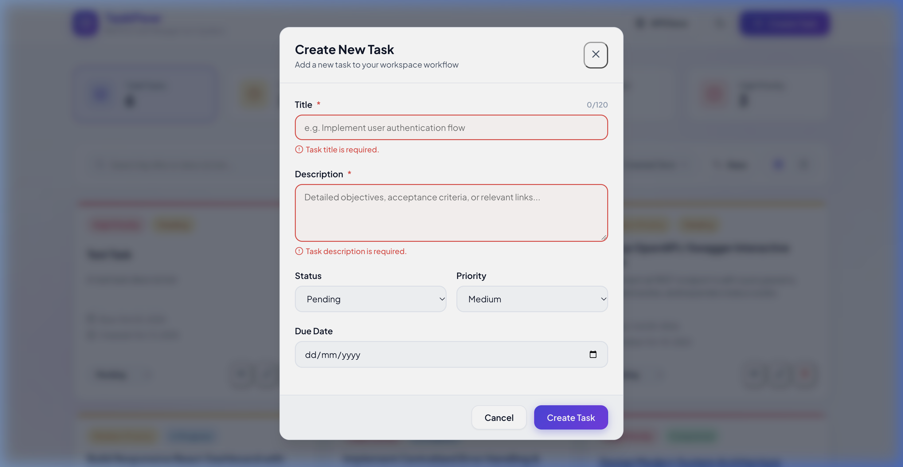
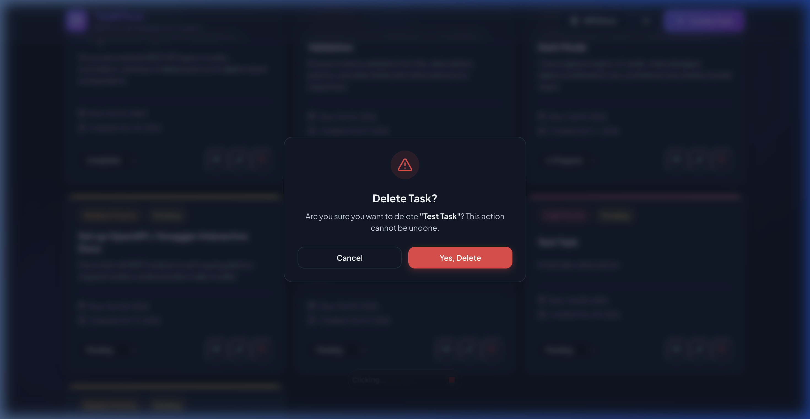

# ⚡ TaskFlow &bull; Full-Stack Task Management System

> A modern, responsive full-stack task management application featuring an Express REST API with clean layered architecture, in-memory runtime storage, and a React + Vite dashboard with dark mode, debounced search, status/priority filtering, sorting, and pagination.

---

## 📸 Application Preview

| Dashboard & Cards View | Table List View |
| :---: | :---: |
|  |  |

| Form Validation & Error States | Deletion Confirmation Dialog |
| :---: | :---: |
|  |  |

---

## 🎯 Key Features & Requirements Met

### 1. Frontend Capabilities (React.js + Vite)
- **Interactive Dashboard**: Real-time stats bar with count metrics (Total, Pending, In Progress, Completed, High Priority) that also act as quick status filters.
- **Task Creation**: Modal form with client-side field validation, title character counter, and instant list & stats refresh.
- **Task Editing**: Seamlessly edit title, description, status, priority, and due date.
- **Task Details Drawer**: Slide-over drawer with complete task metadata, formatted timestamps, overdue warnings, and quick status action buttons.
- **Task Deletion**: Double-confirmation dialog to prevent accidental deletion.
- **States Handled**: Shimmer loading skeletons, empty state illustration with reset button, and toast notifications.
- **Responsive Layout**: Designed for seamless usability across mobile, tablet, and desktop viewports.

### 2. Backend Capabilities (Node.js + Express.js)
- **Clean Layered Architecture**: Strict separation of concerns across `routes`, `controllers`, `services`, and `middleware`.
- **In-Memory Storage**: Runtime array storage adhering strictly to the constraint (no database / no Firebase).
- **Comprehensive Validation**: Robust validation middleware checking required fields, string lengths, valid enum values, and date formats.
- **Centralized Error Handling**: Standardized error response structure with HTTP status codes (`200`, `201`, `400`, `404`, `500`).
- **Interactive Swagger Documentation**: Built-in Swagger UI at `http://localhost:5001/api-docs`.
- **CORS & Environment Variables**: Configured for cross-origin requests and flexible `.env` configurations.

### 3. Bonus Features Included
- 🔍 **Debounced Live Search**: Instant title and description filtering with 300ms debounce.
- 🏷️ **Multi-Criteria Filtering**: Filter simultaneously by status and priority.
- 🔃 **Multi-Field Sorting & Direction**: Sort by Created Date, Due Date, Priority, or Title (Ascending / Descending).
- 📄 **Pagination**: Configurable page limit (5, 10, 20 items per page) and page navigation.
- 🌓 **Dark Mode**: Persisted dark/light theme toggle in header.
- 📋 **View Modes**: Switch between Modern Glassmorphic Cards and Dense Table View.
- 📑 **Swagger UI & Postman Collection**: Interactive OpenAPI 3.0 spec + exported Postman v2.1 collection.

---

## 📁 Repository Structure

```text
taskmangement/
├── backend/
│   ├── src/
│   │   ├── controllers/
│   │   │   └── task.controller.js      # Request handlers & response formatting
│   │   ├── middleware/
│   │   │   ├── errorHandler.js         # Centralized 404 and 500 error handlers
│   │   │   └── validator.js            # Input validation middleware
│   │   ├── routes/
│   │   │   └── task.routes.js          # REST API route definitions
│   │   ├── services/
│   │   │   └── task.service.js         # In-memory storage, search, filter, sort logic
│   │   ├── swagger/
│   │   │   └── swagger.json            # OpenAPI 3.0 specification
│   │   ├── app.js                      # Express configuration & middleware
│   │   └── server.js                   # Server entrypoint and graceful shutdown
│   ├── .env.example                    # Backend environment template
│   ├── package.json
│   └── README.md
├── frontend/
│   ├── src/
│   │   ├── components/
│   │   │   ├── Header.jsx              # Navbar with brand, theme toggle & actions
│   │   │   ├── StatsBar.jsx            # Metric counters & quick filters
│   │   │   ├── FilterBar.jsx           # Debounced search, dropdowns, view toggle
│   │   │   ├── TaskCard.jsx            # Glassmorphic task card with quick actions
│   │   │   ├── TaskTable.jsx           # Dense tabular list view
│   │   │   ├── TaskModal.jsx           # Create / Edit task form modal
│   │   │   ├── TaskDetailsDrawer.jsx   # Slide-over drawer with full metadata
│   │   │   ├── DeleteConfirmModal.jsx  # Deletion confirmation modal
│   │   │   ├── Pagination.jsx          # Pagination controls
│   │   │   ├── LoadingSkeleton.jsx     # Shimmer skeleton loader
│   │   │   ├── EmptyState.jsx          # Illustrated empty state
│   │   │   └── Toast.jsx               # Feedback notifications
│   │   ├── context/
│   │   │   └── ThemeContext.jsx        # Dark / Light mode provider
│   │   ├── hooks/
│   │   │   └── useDebounce.js          # Debounced value hook
│   │   ├── services/
│   │   │   └── api.js                  # Centralized fetch client for backend APIs
│   │   ├── App.css                     # Component layout styles
│   │   ├── index.css                   # Global tokens and design system
│   │   ├── App.jsx                     # Application state and coordination
│   │   └── main.jsx                    # React entrypoint
│   ├── .env.example                    # Frontend environment template
│   ├── index.html                      # HTML with SEO tags & Google Fonts
│   ├── vite.config.js                  # Vite configuration with backend proxy
│   └── package.json
├── docs/
│   └── screenshots/                    # Application demo screenshots
├── TaskFlow_API.postman_collection.json # Exported Postman collection
└── README.md
```

---

## 🛠️ Technology Stack

- **Frontend**: React 19, Vite, Lucide React Icons, Vanilla CSS (Design Tokens & Glassmorphism)
- **Backend**: Node.js (v20+ / v26+), Express.js 4.x, CORS, Dotenv, Swagger UI Express
- **API Spec**: OpenAPI 3.0 (Swagger) & Postman Collection v2.1
- **Persistence**: Runtime In-Memory Array (No Database / No Firebase)

---

## 🚀 Getting Started & Installation

### Prerequisites
- [Node.js](https://nodejs.org/) (version 18.x or later)
- [npm](https://www.npmjs.com/) (version 9.x or later)

---

### Step 1: Backend Setup

1. Open a terminal and navigate to the `backend` folder:
   ```bash
   cd backend
   ```
2. Copy the sample environment file:
   ```bash
   cp .env.example .env
   ```
   *(Default port is `5001` to avoid macOS AirPlay Receiver port 5000 conflicts).*
3. Install dependencies:
   ```bash
   npm install
   ```
4. Start the backend server:
   ```bash
   # Development mode with hot-reloading:
   npm run dev

   # Or standard production mode:
   npm start
   ```
5. Verify the backend is up:
   - Base API: `http://localhost:5001/api/tasks`
   - Healthcheck: `http://localhost:5001/api/health`
   - Swagger Docs: `http://localhost:5001/api-docs`

---

### Step 2: Frontend Setup

1. Open a second terminal window and navigate to the `frontend` folder:
   ```bash
   cd frontend
   ```
2. Copy the sample environment file:
   ```bash
   cp .env.example .env
   ```
3. Install dependencies:
   ```bash
   npm install
   ```
4. Start the Vite development server:
   ```bash
   npm run dev
   ```
5. Open your browser and navigate to:
   ```
   http://localhost:5173
   ```

---

## 📖 REST API Documentation

Base URL: `http://localhost:5001`

| Method | Endpoint | Description | Query / Body Parameters | Expected Status Codes |
| :--- | :--- | :--- | :--- | :--- |
| `GET` | `/api/tasks` | Get all tasks (supports search, filter, sort, pagination) | `search`, `status`, `priority`, `sortBy`, `sortOrder`, `page`, `limit` | `200 OK` |
| `GET` | `/api/tasks/stats` | Get aggregate task metrics | None | `200 OK` |
| `GET` | `/api/tasks/:id` | Get details of a single task | `:id` (path param) | `200 OK`, `404 Not Found` |
| `POST` | `/api/tasks` | Create a new task | `{ title, description, status, priority, dueDate }` | `201 Created`, `400 Bad Request` |
| `PUT` | `/api/tasks/:id` | Update an existing task | `{ title, description, status, priority, dueDate }` | `200 OK`, `400 Bad Request`, `404 Not Found` |
| `DELETE` | `/api/tasks/:id` | Delete a task | `:id` (path param) | `200 OK`, `404 Not Found` |
| `GET` | `/api/health` | Health and uptime status | None | `200 OK` |
| `GET` | `/api-docs` | Interactive Swagger UI docs | Browser | `200 OK` |

### Example API Request (Create Task)
```http
POST /api/tasks
Content-Type: application/json

{
  "title": "Complete assignment",
  "description": "Build the full-stack task manager",
  "status": "pending",
  "priority": "high",
  "dueDate": "2026-10-25"
}
```

### Example API Response (201 Created)
```json
{
  "success": true,
  "message": "Task created successfully",
  "data": {
    "id": "task-mv6083e9-knhg",
    "title": "Complete assignment",
    "description": "Build the full-stack task manager",
    "status": "pending",
    "priority": "high",
    "dueDate": "2026-10-25",
    "createdAt": "2026-10-13T01:30:37.233Z",
    "updatedAt": "2026-10-13T01:30:37.233Z"
  }
}
```

### Example API Response (400 Validation Error)
```json
{
  "success": false,
  "message": "Validation failed",
  "errors": [
    { "field": "title", "message": "Title is required and cannot be empty." },
    { "field": "description", "message": "Description is required and cannot be empty." }
  ]
}
```

---

## 📮 Postman Collection Usage

1. Open Postman.
2. Click **Import** in the top left.
3. Drag & drop the `TaskFlow_API.postman_collection.json` file located in the root directory.
4. The collection comes pre-configured with the `{{baseUrl}}` variable set to `http://localhost:5001`.
5. Run the requests to test all endpoints, validation errors, and edge cases.

---

## ⚙️ Environment Variables

### Backend (`backend/.env`)
```ini
PORT=5001
NODE_ENV=development
CLIENT_URL=http://localhost:5173
```

### Frontend (`frontend/.env`)
```ini
VITE_API_URL=http://localhost:5001/api
```

---

## 🔒 Constraints Compliance Checklist
- [x] **No Database**: 100% in-memory data storage (JavaScript array in `task.service.js`).
- [x] **No Firebase**: Zero Firebase dependencies or authentication.
- [x] **Clean Separation**: Route handlers, controllers, business services, and error middlewares are completely decoupled.
- [x] **Responsive UI**: Fully tested and optimized for all screen sizes.
- [x] **Git Repository**: Initialized with clean commit history and proper `.gitignore`.
